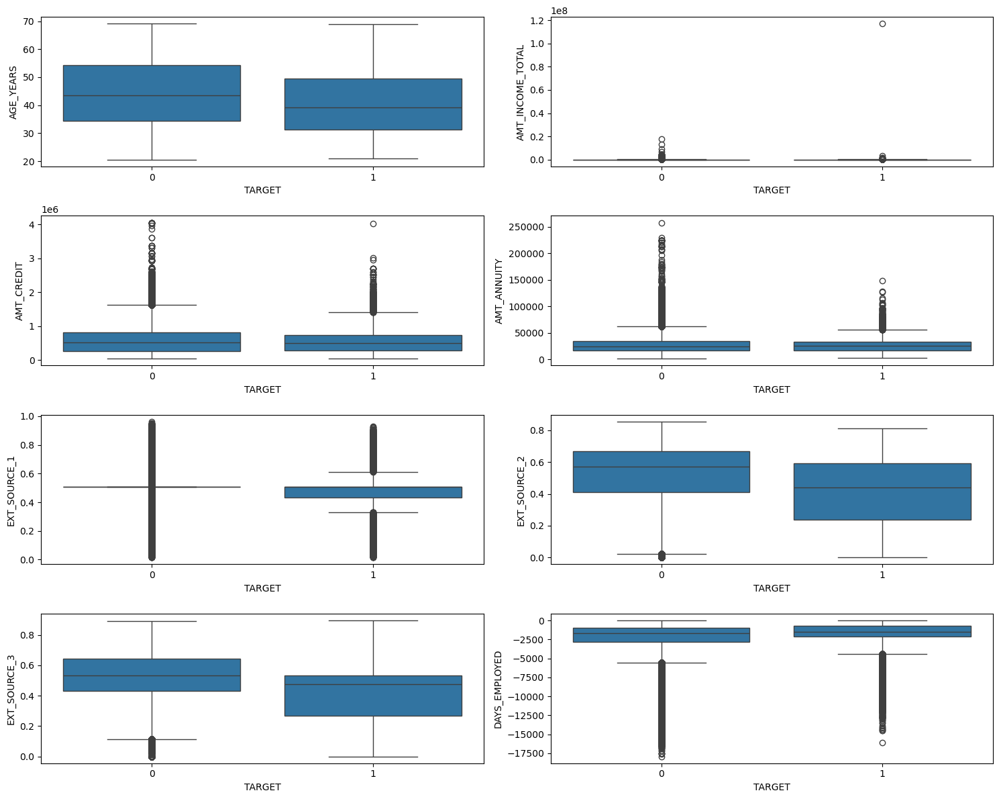
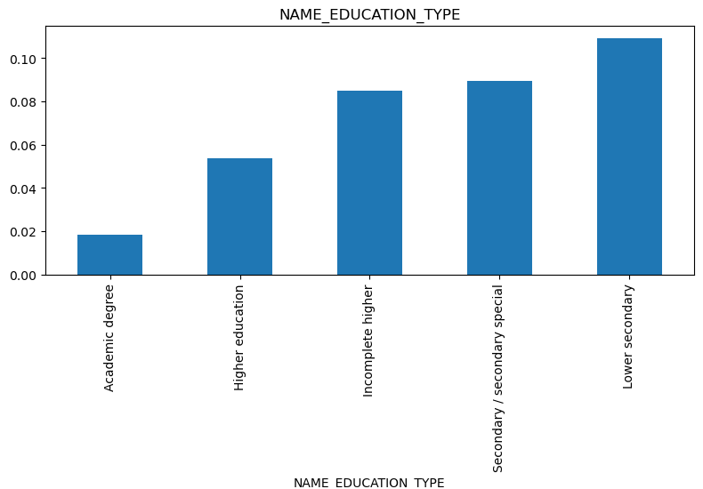

# Home Loan Default Prediction

Predicting which loan applicants will default, using a seven-table credit-history dataset (307,511 applications). The project builds applicant-level features from six auxiliary tables, compares three models, and identifies the factors and customer segments linked to default risk.

**Best model:** LightGBM, **ROC-AUC 0.773** on a held-out test set (logistic regression baseline: 0.639).

**Stack:** Python · pandas · scikit-learn · LightGBM · matplotlib / seaborn · Jupyter

---

## The problem

Given an applicant's loan application plus their earlier credit and payment history, predict whether they will default (`TARGET` = 1) or not (0). Only **8.07%** of applicants default, so a model that always says "no default" would be 92% accurate and completely useless. That is why the project is evaluated with ROC-AUC rather than accuracy.

## Results

| Model | ROC-AUC (test) |
|---|---|
| Logistic Regression (class-weighted) | 0.639 |
| Random Forest (class-weighted) | 0.737 |
| **LightGBM (full data, untuned)** | **0.773** |
| LightGBM (tuned on a 20% subsample) | 0.761 |

Using all six auxiliary tables, rather than `application_train` alone, raised LightGBM's AUC from 0.760 to 0.773, and several features from those tables rank among the model's most important (below).

### Top features (LightGBM)

`EXT_SOURCE_1`, `AMT_CREDIT`, `EXT_SOURCE_2`, `EXT_SOURCE_3`, `AMT_ANNUITY`, `BUREAU_TOTAL_DEBT`, `DAYS_EMPLOYED`, `INST_MAX_LATENESS`, `AMT_GOODS_PRICE`, `BUREAU_TOTAL_CREDIT`

Features engineered from the auxiliary tables (`BUREAU_TOTAL_DEBT` 6th, `INST_MAX_LATENESS` 8th, `BUREAU_TOTAL_CREDIT` 10th) made the top 10, which supports the extra feature-engineering effort. See the limitations below for a caveat on how this importance is measured.

### Who defaults more

- **Younger applicants** (median age about 39 for defaulters vs 43.5 for non-defaulters).
- **Lower external credit scores.** `EXT_SOURCE_1/2/3` are consistently lower for defaulters; this was the strongest single-table signal.
- **Shorter employment tenure.**
- **Lower education.** Default rate climbs steadily from 1.8% (academic degree) to 10.9% (lower secondary).
- **Men** default somewhat more often than women (10.1% vs 7.0%).
- **Higher outstanding debt elsewhere** and a **history of late instalment payments.**




---

## Approach

1. **Multi-table feature engineering.** Six tables (over 30 million rows combined) were aggregated down to one row per applicant and joined to `application_train`. `bureau_balance` was aggregated to `bureau` first, then to the applicant level. Examples: bureau debt and delinquency, previous-application approval rate, point-of-sale and instalment lateness, credit-card utilisation.
2. **Data cleaning.** Placeholder values and missing data were handled column by column (see below).
3. **EDA.** Numeric and categorical features were compared against the target, plus a correlation heatmap.
4. **Encoding.** Binary columns were label-encoded and the rest one-hot encoded, giving 253 features.
5. **Modelling.** A stratified 80/20 split preserved the 92/8 class balance. Imbalance was handled with class weights (`class_weight='balanced'`; `scale_pos_weight` ≈ 11.4 for LightGBM) rather than resampling, avoiding synthetic-sample artefacts on 300k rows.
6. **Tuning.** `RandomizedSearchCV` on a 20% subsample (details below).

## Decisions and problems worth noting

- **A 1,000-year employment placeholder.** `DAYS_EMPLOYED` held the value 365243 in 55,374 rows (about 18%), almost entirely Pensioners and Unemployed applicants. These were flagged with an indicator column, then set to missing and imputed. (The flag ended up with zero importance in the final model, which is reported as-is.)
- **Redundant, mostly-missing columns kept deliberately.** 41 columns were more than 50% missing, largely building attributes reported three ways (`_AVG`, `_MODE`, `_MEDI`). These trios were verified to be missing in exactly the same rows, so they were kept and the model's importance scores decided their relevance, rather than dropping them by hand.
- **"No history" is not always zero.** For counts and sums, no history was filled with 0. For rates and averages (approval rate, utilisation) it was filled with the median, because 0 would wrongly mean "always refused" or "no balance".
- **Tuning made things slightly worse, and that is reported.** A full search ran out of memory on the complete data, so tuning used a 20% subsample. Its parameters scored 0.761 on the test set, below the untuned full-data model (0.773), so the untuned model is the recommendation.
- **LightGBM rejected the column names.** One-hot encoding produced names containing characters like `:` and `,`; these were sanitised with a regex before training.

## Limitations

- **Importance is split-count based.** The feature ranking uses LightGBM's default importance, which counts how often a feature is used in a split. This can favour high-cardinality numeric columns such as `AMT_CREDIT` and `AMT_ANNUITY`, which showed little separation between groups in the EDA. The `EXT_SOURCE` finding is backed by the EDA as well, but a gain-based or SHAP ranking would be a sounder check.
- **One holdout split.** Models are compared on a single 20% test split, not cross-validated, and only ROC-AUC is reported. There is no precision/recall or cost analysis for choosing a decision threshold.
- **Small categories.** Some income types (Maternity leave: 5 rows, Unemployed: 22) show extreme default rates from tiny samples, so they were excluded from the conclusions.
- **Sensitive inputs.** Gender and age are used as features and appear in the findings. A real lending model would need fairness and regulatory review before using them.

---

## Repository structure

```
├── notebooks/home_loan_default.ipynb   # full analysis with outputs and the three reports
├── images/                             # charts used in this README
├── data/raw/README.md                  # where to get and place the data
├── requirements.txt
└── LICENSE
```

The notebook's last section contains the EDA, model-comparison and challenges reports.

## Running it yourself

The data is the public **Home Credit Default Risk** dataset on Kaggle and is not redistributed here. Download it from [kaggle.com/c/home-credit-default-risk](https://www.kaggle.com/c/home-credit-default-risk) and place the seven CSV files in `data/raw/` (see the README there).

```bash
git clone https://github.com/Shyam82adodariya/home-loan-default-prediction.git
cd home-loan-default-prediction
python -m venv .venv && .venv\Scripts\activate      # Windows
pip install -r requirements.txt
jupyter notebook notebooks/home_loan_default.ipynb
```

The bureau and instalment tables hold tens of millions of rows, so expect it to be memory-hungry: in the original run, a full hyperparameter search on all rows ran out of memory, which is why tuning used a subsample.
